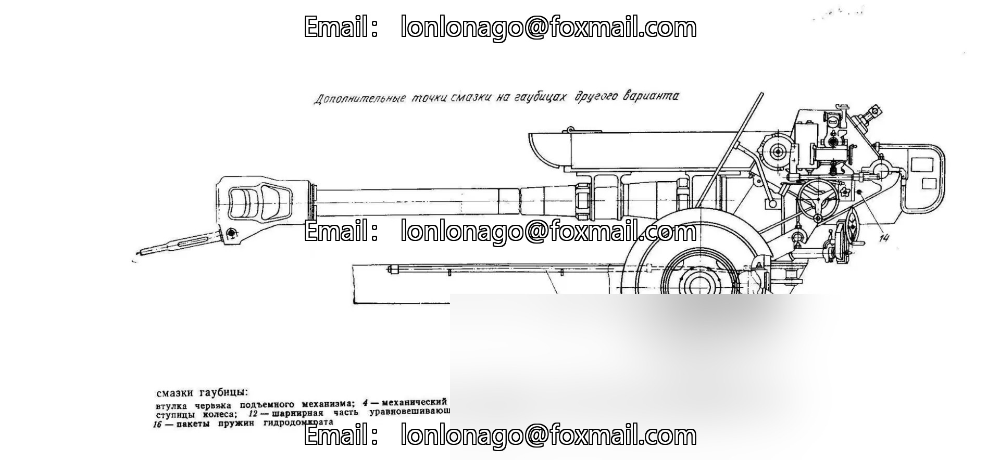
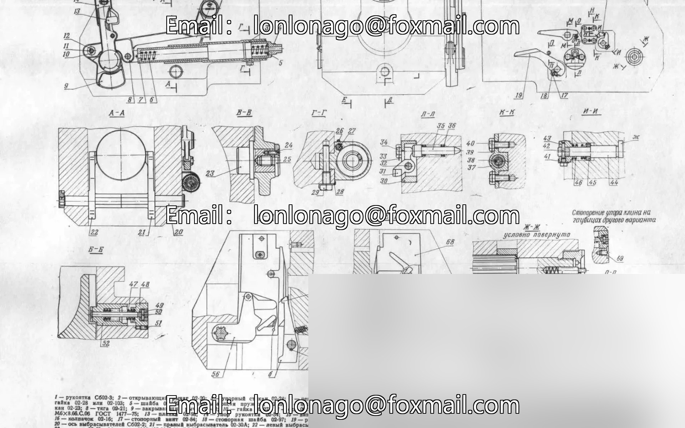
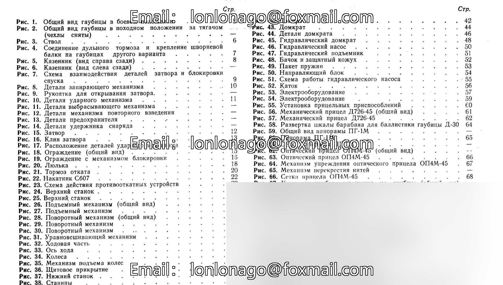
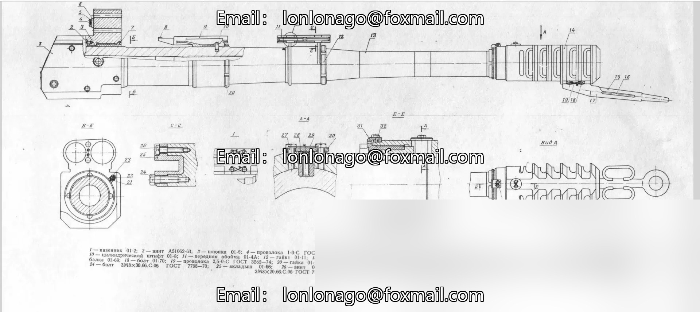
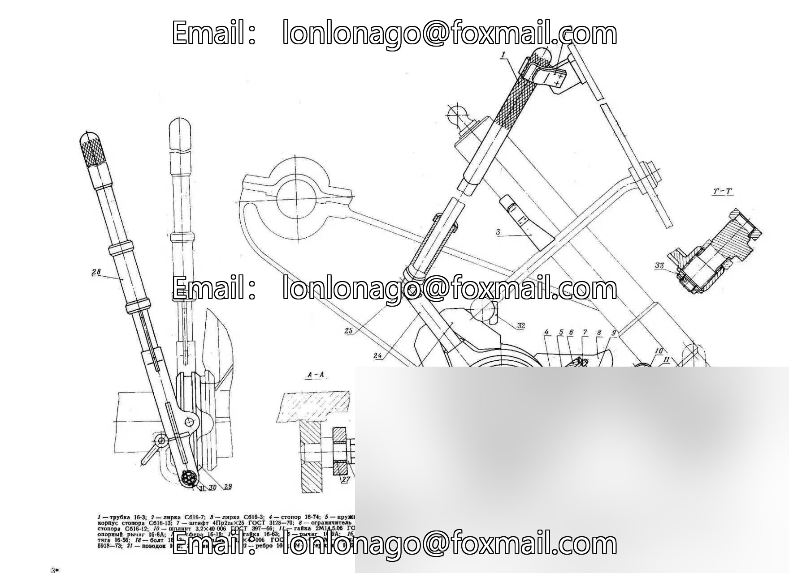

# Russian-made 122 mm grenade cannon D-30 (2A18)

## Body

Russian-made 122-millimeter guided cannon D-30 (2A18)
Drawing set, Russian original, PDF , complete content, including detailed materials such as full vehicle structure, cannon system, power unit, electrical equipment, suitable for military enthusiasts, model making, and professional study reference.

The materials are electronic, sent immediately upon taking photo, provide only for learning and exchange, not refundable or exchangeable upon sale.

If you need, you can communicate privately, and if you need details, you can ask.

This is the Russian-made 122-mm round projectile gun D-30 (2A18); a Russian original PDF is provided, containing complete details on the full vehicle, artillery system, power plant and electrical equipment, and is marked as ready for dispatch, intended for study and exchange only.

<!-- AI_ENRICHED -->

## Images

## Payment

Here is a pay link on Stripe ( https://buy.stripe.com/3cs8yP7sY87d0vu9AB ). Please contact me lonlonago@foxmail.com after funding $89, and I will send you a complete data files , thank you!

